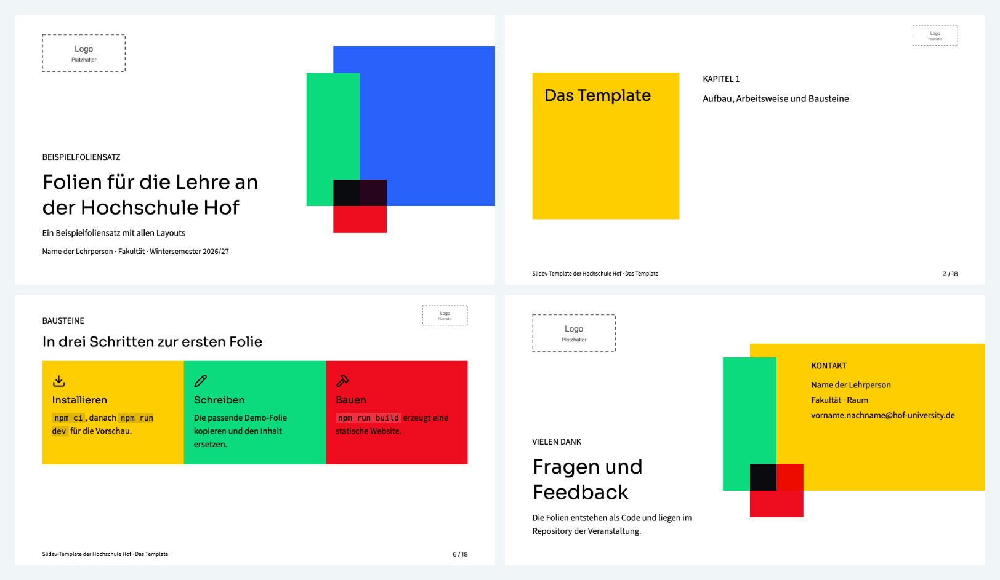

# Slidev-Template der Hochschule Hof

Ein wiederverwendbares [Slidev](https://sli.dev)-Template für Lehrveranstaltungen im Erscheinungsbild der Website der Hochschule Hof. Es enthält ein Theme mit zwölf Layouts, einen Beispielfoliensatz, eine Prüfung für Folienquellen und diese Anleitung.

> **Inoffiziell.** Die Hochschule Hof hat dieses Template nicht freigegeben. Ihr Logo ist nicht im Repository enthalten, weil die Nutzungsrechte noch nicht geklärt sind. Herkunft, Rechte und Annahmen stehen in [docs/quellen.md](docs/quellen.md).



## Schnellstart

```bash
git clone https://github.com/Hafflgav/slidev-template-hs-hof.git
cd slidev-template-hs-hof
npm ci
npm run dev
```

`npm run dev` öffnet den Beispielfoliensatz im Browser unter http://localhost:3030.

## Voraussetzungen

- Node.js 22.22 oder neuer und npm. Geprüft mit Node.js 22.23, 24.22 und 26.13.
- Für den Export als PDF oder PNG Chromium. `npm ci` lädt es einmalig über `playwright-chromium` (rund 570 MB). Wer nicht exportiert, setzt vorher `PLAYWRIGHT_SKIP_BROWSER_DOWNLOAD=1`.

Ab npm 12 sind Installationsskripte von Abhängigkeiten gesperrt. `allowScripts` in der `package.json` gibt das Skript von `playwright-chromium` frei. `fsevents` braucht sein Skript nicht, weil es die kompilierte Datei bereits mitbringt, und bleibt gesperrt.

## Logo einrichten

Das Theme sucht das Logo unter `brand/logo.svg` im Ordner des Foliensatzes, hier also unter `deck/brand/logo.svg`. Fehlt die Datei, zeigen die Folien einen gestrichelten Platzhalter.

1. **Empfohlen:** eine freigegebene Logodatei bei der Hochschulkommunikation anfordern und als `deck/brand/logo.svg` ablegen (`logo.png` und `logo.webp` sind ebenfalls möglich). Ihre Herkunft danach in [docs/logo-herkunft.json](docs/logo-herkunft.json) eintragen, sonst meldet `npm run check` einen Fehler.
2. **Bis dahin:** `bash scripts/logo-aus-flyer.sh` erzeugt die Datei lokal aus einem öffentlichen Flyer der Hochschule und prüft sie gegen die dokumentierten Prüfsummen. Dafür werden `curl`, `pdftocairo` (Poppler, etwa `brew install poppler`), `python3` und `shasum` gebraucht. Geprüft mit Poppler 26.11.0 und cairo 1.18.6.

Auch dieser Weg ist nicht freigegeben: Folien, PDFs und Builds, die Studierende erhalten oder die veröffentlicht werden, enthalten das Logo (offener Punkt 1 in [docs/quellen.md](docs/quellen.md)).

Die Logodatei nicht einchecken. `deck/brand/` steht in `.gitignore`. `npm run check` findet Kopien der Logodatei außerhalb von `deck/brand/` schon vor dem Commit. Ob `deck/brand/` oder Exporte trotzdem eingecheckt wurden, meldet die CI erst nach dem Push.

## Befehle

| Befehl | Ergebnis |
|---|---|
| `npm run dev` | Vorschau mit Live-Aktualisierung; `o` öffnet die Übersicht, der Präsentationsmodus liegt unter http://localhost:3030/presenter/ |
| `npm run check` | Prüfung der Folienquellen und des Themes, siehe unten |
| `npm run build` | statische Website in `deck/dist` |
| `npm run export` | `folien.pdf`, eine Seite pro Folie im Endzustand |
| `npm run export:klicks` | `folien-klicks.pdf`, eine Seite pro Klickschritt |
| `npm run vorschau` | jede Folie als PNG in `.slidev/vorschau/`; eine einzelne mit `npm run vorschau -- --range 5` |
| `npm run vorschau:bild` | erneuert `docs/vorschau.png` aus den Folien 1, 3, 6 und 18; legt `deck/brand/` dafür kurz beiseite, damit das Bild den Platzhalter zeigt |

Weitere Varianten:

- Ohne Sprechernotizen bauen, etwa für eine öffentliche Seite: `npx slidev build deck/slides.md --without-notes`
- Unter einem Unterpfad wie bei GitHub Pages: `npx slidev build deck/slides.md --base /slidev-template-hs-hof/`
- PDF mit einem installierten Chrome statt des heruntergeladenen Chromium: `npx slidev export deck/slides.md --executable-path "/Applications/Google Chrome.app/Contents/MacOS/Google Chrome"`

Ein Build enthält standardmäßig die Sprechernotizen und, falls lokal vorhanden, das Logo. Vor einer Veröffentlichung des Builds, etwa auf GitHub Pages, deshalb die offene Logo-Freigabe beachten. Die Lizenzhinweise für Schriften und übernommenen Code legt der Build unter `lizenzen/` ab.

## Die Prüfung

`npm run check` führt `bin/check.mjs` aus. Es braucht keinen Browser und bricht bei Fehlern mit Exit-Code 1 ab.

| Regel | Prüft |
|---|---|
| `theme-missing` | ein Theme-Pfad wie `./node_modules/slidev-theme-hs-hof` führt zu einem installierten Theme; Slidev selbst baut sonst ohne Fehler, aber ohne Layouts |
| `sanctioned-layout` | nur Layouts des Themes oder eigene Layouts im Ordner `layouts/` des Foliensatzes |
| `invalid-option` | gültige Werte für `color`, `side`, `fit`, `leftIsGood` und die Farbe von `Card` |
| `no-raw-html` | kein rohes HTML, nur Markdown und Komponenten (erlaubt sind `sub`, `sup` und `kbd`) |
| `unknown-component` | nur Komponenten, die es gibt (Theme, Slidev, eigener Ordner `components/`) |
| `no-hardcoded-color` | keine Farbwerte in Attributen, Frontmatter und Mermaid-Diagrammen |
| `no-style-override` | `style` nur für Abstände und Größen, keine Farbklassen, auch nicht in der Frontmatter oder in MDC-Attributen wie `{.text-red-500}` |
| `unknown-icon` | Icons gibt es in Lucide, und `icon` ist als vollständige Klasse geschrieben, etwa `i-lucide-pencil` |
| `heading-single-line` | kein erzwungener Zeilenumbruch im Titel |
| `image-alt` | Alternativtext für Bilder und Diagramme |
| `resources-path`, `resources-missing` | Pfade unter `/resources/…` gibt es, und sie stehen nicht in Markdown-Bildern, die den Build abbrechen würden |

Als Hinweis, ohne abzubrechen, meldet sie zu lange Titel, Listen mit mehr als fünf Punkten (in `compare`, `content-image` und `goodbad` mehr als vier) oder Unterpunkten, Codeblöcke ab 13 Zeilen, Codezeilen mit mehr als 80 Zeichen (in einer Spalte von `compare`, `content-image` und `goodbad` mehr als 40), Tabellen ab acht Zeilen, Tortendiagramme mit mehr als vier Segmenten, eine Agenda ohne Kapitel und Kontaktzeilen ohne Leerzeile dazwischen. Mit `--self`, wie in diesem Repository, kommen hinzu: alle verwendeten Farb-Tokens sind definiert, Farbwerte stehen nur in `styles/theme.css`, `setup/mermaid.ts` und `setup/shiki.ts`, jedes Layout hat eine Demo-Folie mit vollständigem Hinweisblock, die Herkunft einer lokalen Logodatei ist dokumentiert, und außerhalb von `deck/brand/` liegt keine Kopie der Logodatei.

## Aufbau

```text
layouts/              Layouts des Themes
components/           Komponenten wie Agenda, Card, CardGrid, Figure
global/, global-top.vue
                      Logo in der Ecke und Fußzeile mit Kapitel und Seitenzahl
styles/               Farben (theme.css), Schriften, Typografie, Code, Tabellen
setup/                Farben für Mermaid und Code, Markdown-Vorverarbeitung, Kapitelressourcen
composables/, utils/  gemeinsame Logik
assets/               Schriften mit Lizenztexten, Logo-Platzhalter
bin/check.mjs         die Prüfung
deck/                 Beispielfoliensatz
  slides.md           Titel, Agenda, Einbindung der Kapitel, Abschluss
  chapter/NN-name/    NN-name.md und bei Bedarf resources/
  brand/              lokales Logo, nicht im Repository
docs/                 Quellen und Rechte, Logo-Herkunft, Vorschau
scripts/              Logo lokal aus dem Flyer erzeugen, Vorschaubild erneuern
```

## Folien schreiben

Die Regeln für Layouts, Komponenten und Gestaltung stehen in [AUTHORING.md](AUTHORING.md). Das Wichtigste:

- Eine Folie beginnt mit `---` und einer Frontmatter mit `layout:`. Am einfachsten kopiert man die passende Demo-Folie aus `deck/slides.md` oder `deck/chapter/`.
- Jedes Kapitel ist ein Ordner `deck/chapter/NN-name/` mit `NN-name.md` und bei Bedarf einem Ordner `resources/`. Die Kapiteldatei beginnt mit einer `section`-Folie und wird in `deck/slides.md` mit `src:` eingebunden.
- Dateien aus `resources/` sind für Layouts und Komponenten unter `/resources/NN-name/datei` erreichbar, zum Beispiel `<Figure src="/resources/02-prozesse/bestellprozess.svg" alt="…"></Figure>`. Ein Markdown-Bild mit diesem Pfad bricht den Build ab.
- Die erste Demo-Folie jedes Layouts hat oben einen Hinweisblock mit PFLICHT, OPTIONAL, GRENZE und VERWENDUNG. Sprechernotizen stehen im letzten Kommentar einer Folie.

## In einem anderen Repository verwenden

Dieses Repository ist zugleich das npm-Paket `slidev-theme-hs-hof`. Ein Foliensatz in einem anderen Repository, etwa dem der Lehrveranstaltung, bindet es als Abhängigkeit ein. Wann und wie das Repository der Lehrveranstaltung umgestellt wird, ist noch abzustimmen.

**1. Vorbereiten.** Hat das Repository noch keine `package.json`, zuerst `npm init -y` ausführen. Dann Skripte und die Freigabe für das Installationsskript von `playwright-chromium` eintragen; die Freigabe muss vor der Installation stehen, sonst lädt npm 12 kein Chromium:

```json
"scripts": {
  "dev": "slidev slides.md --open",
  "prebuild": "npm run check",
  "build": "slidev build slides.md",
  "preexport": "npm run check",
  "export": "slidev export slides.md --output folien.pdf",
  "prevorschau": "npm run check",
  "vorschau": "slidev export slides.md --format png --output .slidev/vorschau",
  "check": "hof-slides-check slides.md"
},
"allowScripts": {
  "playwright-chromium": true,
  "fsevents": false
}
```

`prebuild`, `preexport` und `prevorschau` prüfen vor jedem Build und Export. Fehlt das Theme, fehlt auch `hof-slides-check`, und der Befehl bricht ab, statt mit fehlenden Layouts weiterzulaufen. Einen falschen Theme-Pfad in der `slides.md` meldet die Prüfung ebenfalls.

Mit pnpm statt npm gehört die Freigabe vor der Installation in eine Datei `pnpm-workspace.yaml` neben der `package.json`; `allowScripts` gilt dort nicht:

```yaml
allowBuilds:
  playwright-chromium: true
  fsevents: false
```

Fehlt sie, bricht pnpm die Installation mit `ERR_PNPM_IGNORED_BUILDS` ab. Dann `pnpm approve-builds playwright-chromium` ausführen; das trägt die Freigabe nach und lädt Chromium. In den Befehlen unten steht dann `pnpm add` an Stelle von `npm install`. Mit pnpm 12.16 geprüft ist Weg B.

**2. Installieren**, auf einem der beiden Wege:

- **Weg A, Git-Tag.** Setzt einen Tag in diesem Repository voraus, zum Beispiel `v0.1.0`:

  ```bash
  npm install -D -E @slidev/cli@53.1.0 playwright-chromium@1.64.1 github:Hafflgav/slidev-template-hs-hof#v0.1.0
  ```

  Ab npm 12 sind Git-Abhängigkeiten gesperrt. Dort `--allow-git=all` anhängen oder `allow-git=all` in die `.npmrc` des Projekts schreiben.

- **Weg B, Paketdatei.** Braucht keine Freigabe für Git-Abhängigkeiten; geprüft mit npm 10 bis 12 und pnpm 12. Im Template-Repository `npm pack` ausführen; das erzeugt `slidev-theme-hs-hof-<version>.tgz`, etwa `slidev-theme-hs-hof-0.1.0.tgz`. Diese Datei in den Ordner `vendor/` des anderen Repositorys kopieren und dort installieren, `<version>` durch die Version im Dateinamen ersetzt:

  ```bash
  npm install -D -E @slidev/cli@53.1.0 playwright-chromium@1.64.1 ./vendor/slidev-theme-hs-hof-<version>.tgz
  ```

  Die `.tgz`-Datei wird mit eingecheckt.

**3. Einrichten.** Die Kopfzeilen der `slides.md`:

```yaml
---
theme: ./node_modules/slidev-theme-hs-hof
lang: de
themeConfig:
  course: Name der Lehrveranstaltung
layout: cover
---
```

Der Pfad statt des Kurznamens `hs-hof` ist Absicht: Fehlt das Paket, bietet Slidev dann nicht an, ein gleichnamiges Paket aus dem öffentlichen npm-Register zu installieren, das jemand anderes veröffentlicht haben könnte. Der Pfad gilt relativ zur `slides.md`. Liegt sie in einem Unterordner, etwa `folien/slides.md`, heißt er `../node_modules/slidev-theme-hs-hof`, und die Skripte nennen `folien/slides.md`.

Dazu eine `.gitignore`. Die `.gitignore` des Templates nicht kopieren, weil sie `*.tgz` ausschließt:

```text
node_modules/
dist/
.slidev/
brand/
*-export/
*-export.*
folien*.pdf
```

**4. Logo.** Wie unter [Logo einrichten](#logo-einrichten) beschrieben anfordern oder erzeugen und als `brand/logo.svg` neben die `slides.md` legen. Das Skript `scripts/logo-aus-flyer.sh` gehört nicht zum Paket: Es in einem Klon dieses Repositorys ausführen und die erzeugte `deck/brand/logo.svg` hinüberkopieren. In einer CI erkennt `test -z "$(git ls-files '*brand/*')"`, wenn das Logo doch eingecheckt wurde, auch in einem Unterordner.

**5. Weiteres.**

- Vorlagen: Die Demo-Folien liegen unter `node_modules/slidev-theme-hs-hof/deck/`.
- Claude Code: `@node_modules/slidev-theme-hs-hof/AUTHORING.md` in die `CLAUDE.md` schreiben, dann gelten die Regeln der installierten Theme-Version.

**Aktualisieren.** Bei Weg A den Tag im Befehl ändern und ihn erneut ausführen. Bei Weg B vor jedem `npm pack` die Version des Templates erhöhen und nie eine `.tgz` durch eine andere mit gleichem Namen ersetzen. `npm version patch` erhöht die Version, braucht dafür einen sauberen Arbeitsstand und legt einen Commit und einen Tag an. Dann im anderen Repository `npm install -D -E ./vendor/slidev-theme-hs-hof-<neue Version>.tgz` ausführen und die alte Datei löschen. In beiden Fällen danach `npm run check` und `npm run build` ausführen und `package.json`, die Lockdatei (`package-lock.json` oder `pnpm-lock.yaml`) und gegebenenfalls `vendor/` zusammen einchecken.

## Gestaltung

Die Gestaltung folgt der Website der Hochschule, weil keine öffentliche Gestaltungsrichtlinie zu finden war: weißer Grund, schwarze Schrift, Sora für Überschriften, Source Sans 3 für Text, eckige Farbflächen in Blau, Rot, Gelb und Grün ohne Schatten und als wiederkehrendes Motiv Flächen, die sich multiplizierend überlagern. Welche Werte von wo stammen und was angepasst wurde, steht in [docs/quellen.md](docs/quellen.md). Liegt eine offizielle Richtlinie vor, wird das Template damit abgeglichen.

## Fehlerbehebung

- **Fehler beim Start oder Warnung `EBADENGINE`:** Node.js 22.22 oder neuer installieren.
- **PDF- oder PNG-Export meldet „Executable doesn't exist“:** `npx playwright install chromium` ausführen oder mit `--executable-path` ein installiertes Chrome nutzen.
- **Platzhalter statt Logo:** `brand/logo.svg` fehlt im Ordner des Foliensatzes, siehe [Logo einrichten](#logo-einrichten).
- **Slidev fragt, ob es `slidev-theme-hs-hof` installieren soll:** ablehnen. Das Paket steht nicht im npm-Register; stattdessen die Installation oben wiederholen.
- **`npm audit` meldet Schwachstellen:** Sie stammen aus Abhängigkeiten von Slidev selbst. `npm audit fix --force` nicht ausführen; es stuft Slidev unter die unterstützte Version herab, und das Theme startet dann nicht mehr.
- **„(global)“ in der Startmeldung von Slidev:** normal, weil der Beispielfoliensatz im Unterordner `deck/` liegt.
- **`ERR_PNPM_IGNORED_BUILDS` bei der Installation mit pnpm:** Die Freigabe in `pnpm-workspace.yaml` fehlt, siehe [In einem anderen Repository verwenden](#in-einem-anderen-repository-verwenden).
- **Icon fehlt:** Lucide-Klassen wie `i-lucide-pencil` vollständig ausschreiben. Aus Variablen zusammengesetzte Namen erzeugt UnoCSS nicht. Namen, die es in Lucide nicht gibt, meldet `npm run check`.

## Lizenz

Noch nicht festgelegt, siehe offenen Punkt 4 in [docs/quellen.md](docs/quellen.md). Bis dahin räumt das Repository keine Nutzungsrechte ein. Übernommene Teile Dritter und die Lizenzen der Schriften und Icons stehen in [THIRD_PARTY_NOTICES.md](THIRD_PARTY_NOTICES.md).
