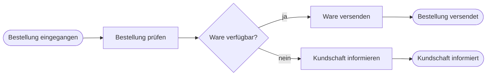

# Beispiel: Prozesse modellieren

Wie eine Lehreinheit mit dem Template aussehen kann

<!--
Zweites Kapitel: eine kurze Lehreinheit als Beispiel für die übrigen Layouts.
-->

---
layout: hero
---

<!--
PFLICHT: eine Überschrift, am besten eine Frage, die die folgenden Folien beantworten.
OPTIONAL: ein bis zwei Sätze daneben; color (blue, yellow, green, red); side (left, right).
GRENZE: Frage höchstens vier Zeilen in der Fläche, keine Aufzählung.
VERWENDUNG: Leitfrage oder Kernaussage. Mehrere pro Foliensatz sind in Ordnung.
-->

# Wann ist ein Prozessmodell gut?

Ein gutes Modell beantwortet eine Frage für eine bestimmte Zielgruppe. Die nächsten Folien zeigen, woran man das erkennt.

<!--
Frage an die Gruppe stellen, kurz sammeln, dann auflösen.
-->

---
layout: mermaid
kicker: Prozesse modellieren
---

<!--
PFLICHT: eine Überschrift und ein mermaid-Codeblock.
OPTIONAL: kicker, ::caption:: mit einem Satz.
GRENZE: ein Diagramm mit höchstens etwa zehn Knoten.
VERWENDUNG: Abläufe, Sequenzen und Zustände, die als Text entstehen.
-->

# Ein Bestellprozess als Ablauf

::caption::

Mermaid erzeugt das Diagramm aus Text, gut für einfache Abläufe.

<!--
Der Ablauf als Text: schnell geschrieben und leicht zu ändern, aber ohne BPMN-Notation.
-->

---
layout: diagram
kicker: Prozesse modellieren
diagram: /resources/02-prozesse/bestellprozess.svg
diagramAlt: BPMN-Diagramm des Bestellprozesses mit Startereignis, drei Aufgaben, einem exklusiven Gateway und zwei Endereignissen
source: eigene Darstellung
---

<!--
PFLICHT: eine Überschrift, diagram (Pfad zur Datei) und diagramAlt.
OPTIONAL: kicker, source (Quellenangabe), ::caption:: mit einem Satz.
GRENZE: ein Diagramm, eine kurze Bildunterschrift.
VERWENDUNG: SVG- oder PNG-Export aus einem Modellierungswerkzeug, zum Beispiel BPMN aus dem Camunda Modeler oder von bpmn.io. Die Datei liegt im resources-Ordner des Kapitels.
-->

# Derselbe Prozess in BPMN

::caption::

Exportierte Diagramme liegen im Kapitelordner unter resources.

<!--
Gleicher Ablauf in BPMN-Notation: Startereignis, Aufgaben, exklusives Gateway, Endereignisse.
-->

---
layout: content
kicker: Prozesse modellieren
---

# Der Ablauf Schritt für Schritt

<SplitView ratio="1/2">
<template #visual>
<Figure src="/resources/02-prozesse/ablauf.svg" alt="Drei Schritte untereinander: Prüfen, Entscheiden, Abschließen" source="eigene Darstellung"></Figure>
</template>

<StepList>
<Step label="Prüfen">Die Bestellung wird auf Vollständigkeit geprüft.</Step>
<Step label="Entscheiden">Das Gateway fragt, ob die Ware **verfügbar** ist.</Step>
<Step label="Abschließen">Ware versenden oder die Kundschaft informieren.</Step>
</StepList>

</SplitView>

<!--
SplitView stellt eine Grafik neben eine Erklärung, StepList nummeriert die Schritte. Grafiken neben Text brauchen große Beschriftungen, weil sie verkleinert werden.
-->

---
layout: content-image
kicker: Prozesse modellieren
image: /resources/02-prozesse/drei-fragen.svg
imageAlt: Drei überlappende Quadrate in Gelb, Grün und Blau, beschriftet mit Zielgruppe, Frage und Detailgrad
fit: contain
source: eigene Darstellung
---

<!--
PFLICHT: eine Überschrift, image und imageAlt (rein dekorativ: imageAlt: "").
OPTIONAL: kicker, side (left, right), fit (cover, contain), source (Quellenangabe).
GRENZE: höchstens vier Punkte und ein Bild.
VERWENDUNG: Text mit einem Bild, Foto oder Diagramm. Die Datei liegt im resources-Ordner des Kapitels.
-->

# Drei Fragen vor jedem Modell

1. Wer liest das Modell?
2. Welche Frage soll es beantworten?
3. Wie genau muss es dafür sein?

<!--
Die drei Fragen überlappen: Zielgruppe, Frage und Detailgrad bestimmen sich gegenseitig.
-->

---
layout: compare
kicker: Prozesse modellieren
---

<!--
PFLICHT: eine Überschrift, Inhalte in ::left:: und ::right::.
OPTIONAL: kicker, je Seite eine Zwischenüberschrift mit ###.
GRENZE: höchstens vier kurze Punkte pro Seite.
VERWENDUNG: zwei Varianten nebeneinander, zum Beispiel Ist und Soll.
-->

# Ist-Prozess und Soll-Prozess

::left::

### Ist-Prozess

- Bestellungen kommen per E-Mail
- Verfügbarkeit wird telefonisch geklärt
- Antwort nach bis zu zwei Tagen

::right::

### Soll-Prozess

- Bestellungen kommen über ein Formular
- Das System prüft die Verfügbarkeit
- Bestätigung sofort nach dem Absenden

<!--
Gleiche Struktur auf beiden Seiten erleichtert den Vergleich.
-->

---
layout: goodbad
kicker: Prozesse modellieren
leftIsGood: false
---

<!--
PFLICHT: eine Überschrift als Frage, Inhalte in ::left:: und ::right::, leftIsGood.
OPTIONAL: kicker, ::legend:: mit der Begründung, leftLabel und rightLabel, goodLabel und badLabel.
GRENZE: kurze Inhalte, Begründung in einem Satz.
VERWENDUNG: „Welche Variante ist richtig?“ Die Bewertung erscheint beim ersten Klick. leftIsGood von Folie zu Folie wechseln, damit die Lösung nicht immer auf derselben Seite steht.
-->

# Welche Benennung ist besser?

::left::

Aufgabe „Rechnung“

::right::

Aufgabe „Rechnung prüfen“

::legend::

Aufgaben werden mit Objekt und Verb benannt. So ist klar, was getan wird.

<!--
Erst raten lassen, dann klicken. Im PDF ist die Auflösung sofort sichtbar.
-->

---
layout: interactive
kicker: Übung · 10 Minuten
icon: i-lucide-pencil-ruler
---

<!--
PFLICHT: eine Überschrift mit der Aufgabe oder Frage an die Gruppe.
OPTIONAL: kicker, zum Beispiel „Übung · 10 Minuten“; icon als Lucide-Klasse i-lucide-…; color der Symbolfläche (yellow, green, red, blue); ein bis zwei Sätze.
GRENZE: eine Aufgabe pro Folie.
VERWENDUNG: übergibt an das Publikum, etwa für eine Übung, Diskussion oder Abstimmung.
-->

# Modellieren Sie die Rücksendung einer Bestellung.

Arbeiten Sie zu zweit. Verwenden Sie höchstens sechs Aufgaben und ein Gateway.

<!--
Zeit stoppen, danach zwei Lösungen vorstellen lassen.
-->
