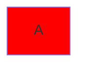

# Fehlalarme

---
layout: content
meta: Raum #101
---

# Text mit Nummern

Ticket #123456 und #facade im Text, [Anker](#deface), Issue #123.

~~~css
.x { color: #ff0000; }
~~~

- Punkt mit Code
  ```css
  .y { color: #00ff00; }
  ```

<card-grid cols="2">
<card title="Kebab">Text.</card>
</card-grid>

Für i<n gilt a<b ist kleiner.

<v-click>Text</v-click>

Hochgestellt<sup>2</sup> und <kbd>Strg</kbd>.

---
layout: compare
---

# Vier und vier

::left::

- a
- b
- c
- d

::right::

- e
- f
- g
- h

---
layout: content
---

# Listen und Werte

- Erster Punkt, der in der
  nächsten Zeile weitergeht
- Zweiter Punkt
mit fauler Fortsetzung

- Dritter Punkt nach Leerzeile

  Zweiter Absatz im dritten Punkt
- Vierter Punkt
- Fünfter Punkt

<Card title="#101" icon="i-lucide-pencil-ruler">Raum.</Card>

<Figure src="/bild.svg" caption="Eingabe -> Ausgabe" alt="Ablauf"></Figure>

Ein Anker {#anker} und eine Menge {a, b}.

````md
```
<Card title="Zaun im Zaun" class="text-red-500">Text.</Card>
```
````

---
layout: content
---

# Weitere erlaubte Formen

<Card title="Doppelpunkt" icon="i-lucide:pencil">Text.</Card>

<Card title="Maske" icon="i-lucide-pencil?mask">Text.</Card>

- Eins
 - Zwei, ein Leerzeichen eingerückt und trotzdem kein Unterpunkt
- Drei

```js
const zwischen = 'zwei Listen'
```

- Vier
- Fünf
- Sechs

````md

````

````md magic-move
```js
const a = 1
const b = 2
const c = 3
```
```js
const a = 1
const b = 2
const d = 4
```
```js
const a = 1
const b = 2
const c = 3
const d = 4
```
````

---
layout: content
---

# Formeln, Trennlinien, Beispiel im Beispiel

- a
- b
- c
$$
x^2
$$

- d
- e
- f

***

- g
- h
- i

- ```html
  <div>Codeblock in der Zeile des Listenpunkts</div>
  ```

```md
- Schritt

    ```bash
    npm ci
    ```
<div>gehört noch zum Beispiel</div>
```

---
layout: interactive
icon: i-lucide-pencil
---

# Gültiges Icon
