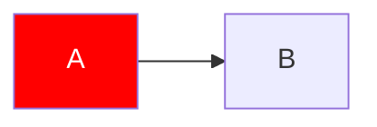
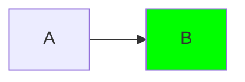

# Lücken

---
layout: content
class: bg-red-500 text-white
---

# Klasse in der Frontmatter

<Card class="text-red hover:text-red-500 !text-white c-red-500 bg-red-500/50 mt-4">Text.</Card>

<Card color="gelb" title="Falsche Farbe">Text.</Card>

<Crad title="Tippfehler">Text.</Crad>

<Figure
  src="/resources/01-p/fehlt.svg"></Figure>

Text

- 1
- 2
- 3
- 4
- 5
- 6
  - Unterpunkt

---
layout: content
---

# Weitere Farbformen und Icons

<Card class="text-red-5 text-violet6 color-#ff0000 mt-4">Text.</Card>

<Card title="A -> B" class="text-blue">Text.</Card>

[Rot]{.text-red-500} und [Blau]{style="color: blue"}

<Card title="Tippfehler im Icon" icon="i-lucide-pencl">Text.</Card>

<Card title="Icon ohne Präfix" icon="pencil">Text.</Card>

<card title="kebab ohne Präfix" icon="pencil">Text.</card>

<card title="kebab gelb" color="gelb">Text.</card>

---
layout: interactive
icon: i-lucide-gibt-es-nicht
---

# Unbekanntes Icon

---
layout: hero
color: gelb
---

# Farbe auf Deutsch?

---
layout: content-image
image: /resources/01-bilder/bild.png
imageAlt: Tippfehler im Kapitel
---

# Bildpfad falsch

---
src: ./chapter/01-p/01-p.md
layout: contnet
---
