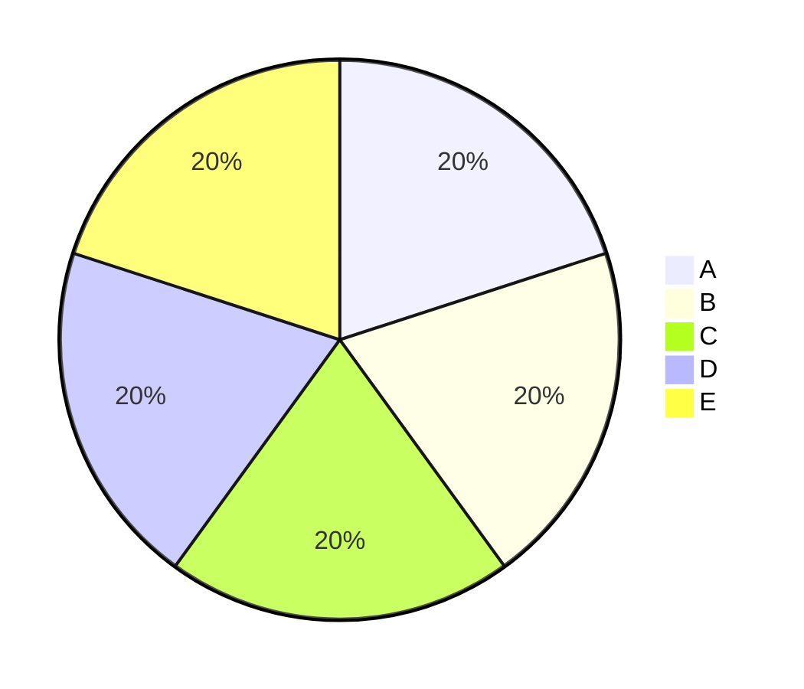

# Ein sehr langer Titel für die Titelfolie, der deutlich mehr als zwei Zeilen braucht

---
layout: content
---

# Agenda

<Agenda></Agenda>

---
layout: content
---

# Lange Liste

- Eins, mit einer Zeile,
  die eingerückt weitergeht
- Zwei
mit fauler Fortsetzung
- Drei

- Vier nach einer Leerzeile
- Fünf
- Sechs

---
layout: content
---

# Langer Code

```js
const a = 1
const b = 2
const c = 3
const d = 4
const e = 5
const f = 6
const g = 7
const h = 8
const i = 9
const j = 10
const k = 11
const l = 12
const m = 13
```

---
layout: compare
---

# Zwei Spalten

::left::

- a
- b
- c
- d
- e

::right::

```js
const zuLang = 'Diese Zeile ist für eine Spalte zu lang'
```

---
layout: mermaid
---

# Torte



---
layout: content
---

# Lange Tabelle

| Nr. | Wert |
|---|---|
| 1 | a |
| 2 | b |
| 3 | c |
| 4 | d |
| 5 | e |
| 6 | f |
| 7 | g |
| 8 | h |

---
layout: closing
---

# Vielen herzlichen Dank für Ihre Aufmerksamkeit

::contact::

Name der Lehrperson
Raum B 123
